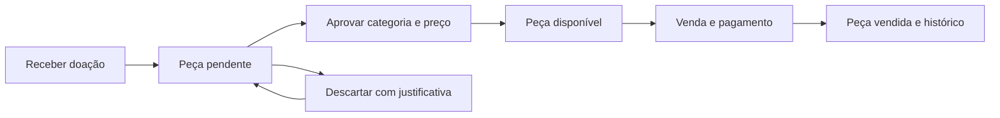

# Estado atual — 09/11/2026

Este documento registra a implementação atual. Os materiais acadêmicos e desenhos anteriores
permanecem no repositório para rastreabilidade; quando houver divergência, consulte as regras
implementadas na [documentação do backend](../backend/README.md).

## Componentes

| Parte | Implementação | Execução |
|---|---|---|
| Front-end | React 18, TypeScript, Vite e Tailwind; interface acessível para uso interno | [Guia](../frontend/README.md) |
| Backend | Java 17, Spring Boot, Spring Security, JDBC e PostgreSQL | [Guia](../backend/README.md) |
| Banco atual da API | Migração Flyway PostgreSQL; sem dados reais ou senha padrão | [Migração](../backend/src/main/resources/db/migration/V1__initial_schema.sql) |
| SQL anterior | Referência histórica MySQL, não utilizada pela API atual | [Scripts antigos](../data/README.md) |

**Front-end e backend ainda não estão conectados.** A interface continua usando dados demonstrativos
e armazenamento no navegador. As permissões seguras e a persistência compartilhada estão na API;
elas passarão a proteger o fluxo da interface quando a integração for concluída.

## Fluxo principal

A API verifica o usuário e seu perfil, valida entradas e registra o autor das operações.
Vendas usam transações e bloqueios no banco: estoque, itens, pagamento e total são gravados juntos.

## Regras confirmadas

- Administradores e responsáveis pela triagem podem aprovar peças; a regra não depende do nome Aline.
- Atendentes podem conceder descontos na venda.
- Toda a equipe, incluindo triagem, pode consultar relatórios e histórico de clientes.
- A gestão de contas fica restrita a administradores.
- A tabela completa de permissões e as restrições monetárias estão no [backend](../backend/README.md#permissões-verificadas-no-servidor).
- O sistema registra o pagamento, mas não executa cobranças bancárias.

## Testes

- Front-end: testes de regras, verificação TypeScript e build.
- Backend: 25 testes, incluindo integração com PostgreSQL real, concorrência entre vendedores,
  falhas transacionais, permissões, login, revogação de sessão e HTTP real.
- Execute novamente os comandos dos guias para validar sua cópia.
- A avaliação de acessibilidade com a equipe da ANG, testes de carga e implantação ainda estão pendentes.

## Próximas entregas

1. Integrar a interface à API e retirar o login demonstrativo do fluxo de uso real.
2. Adaptar IDs numéricos e campos do protótipo ao contrato com UUIDs.
3. Validar a operação completa com a equipe da ANG.
4. Preparar hospedagem, HTTPS, gestão de segredos, backups e restauração.
5. Definir eventual migração dos dados usados na operação real.

## Documentação para integração

- [Contrato HTTP](../backend/API.md)
- [OpenAPI](../backend/openapi.json)
- [Exemplos de requisições](../backend/requests.http)
- [Decisão de arquitetura](decisoes/DECISAO-003-backend-java.md)
