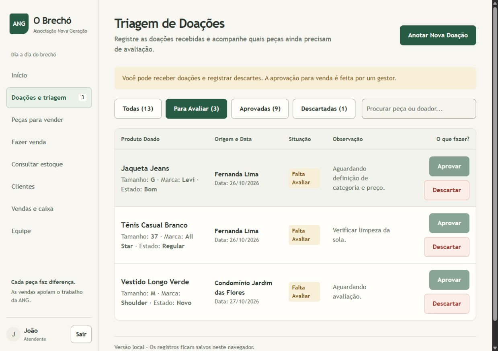
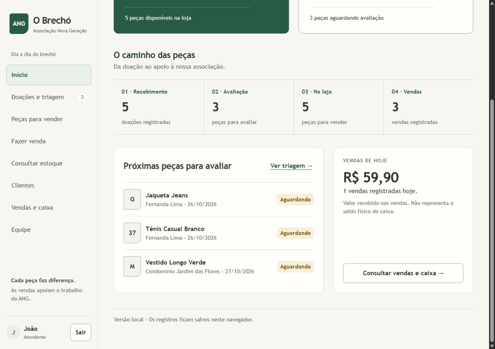

# Redesenho do front-end — 08/11/2026

## Objetivo e decisões confirmadas

Uso interno pela equipe da ANG, com prioridade para pessoas com pouca familiaridade com tecnologia. A interface deve orientar o trabalho com palavras simples, controles grandes, navegação explícita e confirmação antes de registrar uma venda.

Decisões confirmadas pelo responsável pelo projeto nesta revisão:

- Qualquer pessoa com perfil de gestor/administrador ou Responsável pela Triagem pode aprovar peças. A exclusividade nominal da Aline nos documentos anteriores passa a ser uma permissão de perfil. O perfil de triagem foi incluído após revisão do responsável pelo projeto, sem conceder acesso à administração de usuários.
- Atendentes também podem negociar preços e conceder descontos.
- O escopo desta entrega é o front-end. Não foram criados backend, pagamentos on-line ou integração SQL.

## Entendimento do sistema

| Uso | Fluxo e regra | Implementação principal |
|---|---|---|
| Receber uma doação | Informar a origem, inclusive doador anônimo, e os dados da peça. A peça entra pendente e sem preço. | `TriagemView`, `TriagemService` |
| Avaliar uma peça | Gestor ou responsável pela triagem aprova com categoria, preço positivo e localização. Peça inadequada pode ser descartada com motivo. | `TriagemView`, `BrechoContext` |
| Vender | Somente peças disponíveis. Escolher cliente, preços e meio de pagamento. Conferir antes de registrar. | `NovaVendaView`, `VendaService` |
| Registrar a saída | Criar venda, itens e pagamento; marcar peças vendidas; atualizar histórico do cliente. | `BrechoContext` |
| Conferir recebimentos | Filtrar vendas por início/fim, consultar total, quantidade de peças e meios de pagamento. | `RelatoriosView` |
| Conhecer clientes | Cadastro, contato, histórico e peças agrupadas por categoria. | `ClientesView`, `ClienteDetalheView` |
| Administrar equipe | Alterações de acesso exclusivas de gestores; edição sem senha mantém a senha existente. | `AtendentesView`, `BrechoContext` |

As nove entidades existentes foram preservadas: cliente, funcionário, categoria, doação, produto, triagem, venda, item de venda e pagamento. Os serviços continuam executando no navegador e os dados continuam no localStorage. Os arquivos SQL não foram alterados.

## O que mudou na interface

- Início com duas ações principais: fazer venda e receber doação.
- Percurso da peça: recebimento, avaliação, loja e venda, com números reais dos registros locais.
- Navegação visível para todas as áreas, sem menus de ícones sem legenda.
- Catálogo com tamanho em etiqueta, marca, conservação, localização e preço. Adicionar várias peças não substitui a seleção anterior.
- Venda organizada em três passos, com ajustes de preço, revisão final e comprovante coerente.
- Estoque com busca por nome, marca, tamanho e localização, além de situação.
- Caixa com período, estado sem resultados e indicação de datas inválidas.
- Histórico do cliente agrupado por categoria.
- Formulários com rótulos associados; diálogos nativos com contenção de foco, retorno de foco e fechamento por Escape.
- Controles de 48 px (44 px nos compactos), foco visível, redução de movimento, adaptação a telas pequenas e link para pular ao conteúdo.
- Tabelas com região focável e orientação de rolagem em telas estreitas.

## Direção visual

Domínio: doação, sacola, etiqueta, arara, avaliação, balcão e caixa solidário.

Cores: algodão cru, papel claro, linho, verde de tecido e carvão. Âmbar indica pendência; vermelho indica erro ou descarte. A assinatura é o caminho da peça e a etiqueta de tamanho, com o preço apresentado como em uma etiqueta de balcão.

Foram substituídos o painel de cartões equivalentes por duas ações prioritárias; ícones sem contexto por textos; e grandes sombras/gradientes por superfícies discretas. Tipografia local Trebuchet MS, com alternativa Segoe UI, para evitar depender de fontes pela internet. Corpo de 16 px, títulos de 22–32 px, espaçamento baseado em 4 px e superfícies com bordas suaves.

## Correções funcionais

- Aprovação limitada aos perfis de gestão e responsável pela triagem, tanto na tela quanto na operação local.
- Entrada direta que criava aprovação automática desativada; a interface direciona ao recebimento e à triagem.
- Desconto no total distribuído entre os itens em centavos. Subtotais, comprovante, pagamento e venda passam a ter o mesmo total em novas vendas.
- Vendas recusam itens repetidos, indisponíveis, total inválido e pagamento não reconhecido.
- Proteção contra confirmação repetida da mesma venda no mesmo estado da tela.
- Cliente novo só é incluído depois de validar a geração da venda.
- Clientes e funcionários associados ao histórico não podem ser apagados pelas operações locais.
- Senha padrão deixa de funcionar como alternativa universal para contas com outra senha.
- Sessão salva apenas a identificação, recuperando o usuário do cadastro atual.
- Data operacional calculada no fuso de São Paulo.

## Limitações e decisões ainda necessárias

- Autenticação e permissões locais continuam demonstrativas; precisam ser aplicadas no servidor para uso real.
- Não há banco compartilhado, sincronização entre computadores, backup automático ou proteção transacional entre abas.
- Histórico anterior não foi recalculado nem migrado. Divergências antigas de descontos precisam de análise própria.
- Categorias existentes foram preservadas para não reclassificar os dados. Ainda há diferença entre a lista documental e os exemplos (Shorts e Calças; Calçados).
- A interface registra uma peça por recebimento. O serviço suporta várias; recebimento de lotes pode ser uma evolução validada com a equipe.
- Caixa representa recebimentos de vendas, sem despesas, retiradas, troco ou conciliação bancária.
- Duplicidade de clientes, desativação de funcionários, desfazer operações e regras de descontos máximos precisam de definição adicional.
- Acessibilidade foi trabalhada e revisada, mas ainda requer avaliação com usuários da ANG e leitores de tela. Não é uma certificação de conformidade.

## Verificação executada

- `npm run typecheck`: aprovado.
- `npm run build`: aprovado.
- `npm test`: oito testes aprovados, incluindo distribuição de centavos, valores inválidos, disponibilidade, recebimento, perfis, login e data local.
- Navegador: login de gestor e atendente; recebimento de peça de teste; bloqueio de aprovação para atendente; aprovação pelo gestor; venda pelo atendente com desconto; comprovante e caixa com R$ 59,90 e duas peças; recarregamento com manutenção da venda e da baixa no estoque.
- Revisão visual em desktop e viewport de 390 × 844 px. Os registros criados nessa verificação estão identificados como teste na prévia local.
- Calendário: mudança por teclado apresentou erro para intervalo invertido e estado vazio para intervalo sem vendas.
- Teclado: Escape fechou o formulário de doação e devolveu o foco ao botão que o abriu.
- Histórico: a venda apareceu nas categorias de camisa masculina e vestidos, com o total atualizado do cliente.
- Console do navegador sem avisos ou erros na conferência final.

### Capturas da revisão

Consulte este documento para as mudanças desta revisão. Capturas e relatórios anteriores em `docs/prototipos/atual` e `docs/testes` descrevem a versão anterior.
